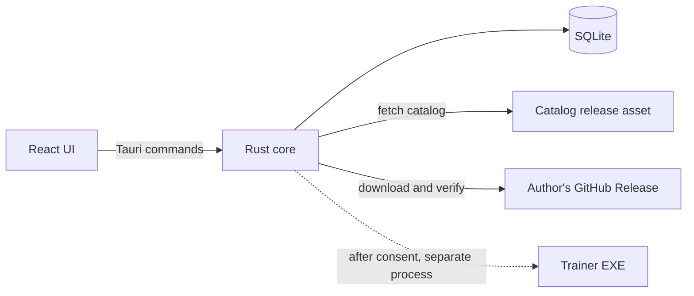

# Architecture

The application is built on the `feat/desktop-app` branch and hasn't been released. Plugin DLLs, catalog signing and app updates are still planned.

## Overview

OpenTrainer is a modular monolith: one Tauri 2 application, split into Rust modules with clear boundaries. There is no mandatory backend server. GitHub hosts the catalog and application releases, and trainer files stay in their authors' GitHub Releases.

## Supported games

The app supports only V Rising for now. `catalog::restrict` removes every other game from the catalog after it's loaded or refreshed, and V Rising's presets are built in rather than downloaded. The community catalog can list more games without the app showing them.

## Rust modules

| Module      | Responsibility                                                        |
| ----------- | --------------------------------------------------------------------- |
| `catalog`   | Fetch, validate and cache the catalog; compare compatibility          |
| `downloads` | Stream to a temporary file, verify size and SHA-256, install the file |
| `library`   | Track installed trainers, versions and removal                        |
| `storage`   | SQLite access and migrations                                          |
| `execution` | Starts a trainer as its own process                                   |
| `presets`   | Builds and writes V Rising world presets                              |

Modules talk through plain Rust interfaces. They become separate crates only if that solves a real problem.

## Key decisions

### Data ownership

- **The catalog is remote data.** The latest valid copy is cached so browsing works offline.
- **SQLite holds only local state:** installed trainers, consent records and settings. It doesn't become a second source of truth for catalog content.

### Keeping the catalog simple

Contributors edit one small file per game and per trainer. CI combines them into `catalog.v1.json` and publishes it as a release asset. This avoids merge conflicts in a shared file and gives the app a single download that works offline.

The version is in the file name. A breaking schema change publishes a new file, such as `catalog.v2.json`, alongside the old one, so existing installs keep working. Within a version, clients must ignore fields they don't recognize.

### Where the backend draws the security line

The frontend displays data and asks for actions. Rust enforces every rule: validation, hashing, consent checks and file paths. The webview gets the smallest possible set of Tauri capabilities, with no general shell or filesystem access.

### Install flow

1. Download the file to a temporary location in the app's data folder, under `%LOCALAPPDATA%`.
2. Stop if the download exceeds the listed size.
3. Compare the SHA-256 hash and delete the file on a mismatch.
4. Move it into place under a name generated by the app, not one taken from the catalog.
5. Keep the Windows "downloaded from the internet" marker so that SmartScreen still applies.

### Execution rules

- The app itself never runs as administrator.
- A trainer is never loaded into the app's process.
- Consent shows the author, license, hash, review limits and whether administrator rights are needed.
- Consent is tied to a file hash, so a changed file asks again.
- Revoked releases are blocked.

## Design review of the approved decisions

| #   | Finding                                                                                                                              | How this foundation handles it                                                                                  |
| --- | ------------------------------------------------------------------------------------------------------------------------------------ | --------------------------------------------------------------------------------------------------------------- |
| F1  | "Maintainer review" can sound like a safety check, but reviewers can't prove that a closed-source EXE is harmless.                   | Docs state the limits of review. Publisher trust stays open as D5.                                              |
| F2  | "Do not commit binaries" didn't say whose Releases host them. Re-hosting needs permission, and licenses vary.                        | Manifests record the license and who hosts the file. Only author-hosted or permitted GitHub Releases pass (D2). |
| F3  | The DLL wording allows loading into the main process "if explicitly trusted". One bad approval would then compromise the whole app.  | Schema v1 accepts only EXE. The recommendation is to remove the exception (D4).                                 |
| F4  | "Plugin DLL" has no definition: there is no host process, interface or target.                                                       | DLL support is deferred until it has a design. It needs schema v2.                                              |
| F5  | There was no way to withdraw a malicious trainer.                                                                                    | Added `SECURITY.md` and a per-release `status`, including `revoked`. Offline behavior is open as D6.            |
| F6  | SHA-256 values come from the catalog, so a compromised catalog could list a bad file with a matching hash.                           | Published hashes can't be edited through review without CI failing, but catalog signing stays open as D5.       |
| F7  | The single-player restriction can't be enforced technically on arbitrary EXEs.                                                       | Required attestations and review enforce it as policy, and docs say so.                                         |
| F8  | Many real trainers ship in ZIP or RAR archives, which an EXE-only flow can't install.                                                | Schema v1 accepts direct `.exe` downloads only. Archive support is open as D3.                                  |
| F9  | Without code signing, Windows shows SmartScreen warnings. Signing and updates weren't covered, and the project avoids paid services. | Open as D7.                                                                                                     |
| F10 | Many trainers need administrator rights, which conflicts with running least-privilege software.                                      | Manifests declare `requiresElevation`. The app itself never elevates.                                           |
| F11 | `catalog.json` as a single unversioned name would break old installs on a schema change.                                             | Published as `catalog.v1.json`.                                                                                 |
| F12 | A pull request can edit the validation scripts that check it.                                                                        | Pull request CI has read-only access and no secrets. Reviewers must check changes to scripts and workflows.     |

## Open decisions

Each needs maintainer approval. The recommendation is what this foundation currently assumes, where it assumes anything.

| #   | Decision                                                                                                                       | Recommendation                                                                        |
| --- | ------------------------------------------------------------------------------------------------------------------------------ | ------------------------------------------------------------------------------------- |
| D1  | License for `opentrainer-trainers`. **Decided.**                                                                               | MIT for scripts, schemas and docs. CC0 for metadata. Trainer files are excluded.      |
| D2  | Where trainer files may be hosted.                                                                                             | GitHub Releases only, either the author's own or with documented permission.          |
| D3  | Whether to support archives.                                                                                                   | Later, with ZIP only. Extraction adds path-traversal risk and multi-file installs.    |
| D4  | DLL rule.                                                                                                                      | Never in the main process, with no trust exception. Design a separate host later.     |
| D5  | Publisher trust and catalog signing.                                                                                           | Start with verified GitHub ownership of the release. Add a free signature before 1.0. |
| D6  | What the app does when its catalog copy is stale, since it can't learn about a revocation while offline.                       | Warn at consent after 7 days. Don't block offline use.                                |
| D7  | Code signing and app updates.                                                                                                  | Apply to SignPath Foundation. Use the Tauri updater with its free signing key.        |
| D8  | Antivirus scanning in the review process. VirusTotal's terms and limits need checking first.                                   | Manual for maintainers at first, with results treated as a signal and not proof.      |
| D9  | Conduct contact and number of required reviewers. The owner is `ahmadreza-log`.                                                | A dedicated contact, and two maintainers when possible.                               |
| D10 | Final name. The workspace folder says "OpenTrainers" while the project says "OpenTrainer". A trademark search is still needed. | OpenTrainer, after a basic search.                                                    |
