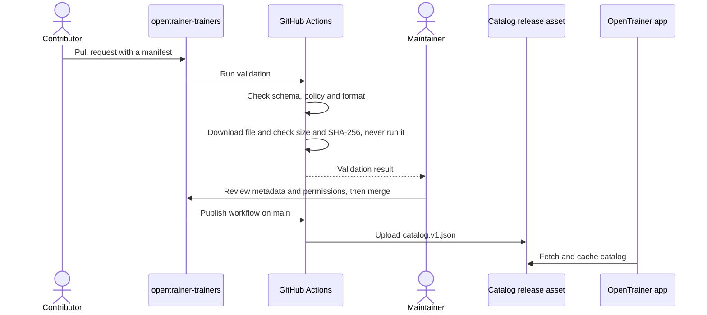

# Repository Relationship and Contribution Workflow

## Three separate places

| Location                            | Contains                                        | Changes through               |
| ----------------------------------- | ----------------------------------------------- | ----------------------------- |
| `opentrainer`                       | Application code, docs and application releases | Pull requests                 |
| `opentrainer-trainers`              | Metadata, schemas, validation and the catalog   | Pull requests                 |
| The trainer author's GitHub Release | The trainer binary                              | The author, outside our repos |

The two repositories are versioned independently. They share one contract: the published catalog schema. The application doesn't depend on the trainers repository's source files or on its layout.

Contributors follow the [trainer submission guide](https://github.com/ahmadreza-log/OpenTrainer-Trainers/blob/main/CONTRIBUTING.md), which covers the licensing evidence each pull request must include. Review results are kept in the [evidence log](https://github.com/ahmadreza-log/OpenTrainer-Trainers/blob/main/docs/catalog-evidence.md).

## Trainer submission

## What the app will do

The steps below are planned.

1. Fetch `catalog.v1.json` and validate it. Keep the previous copy if the new one is invalid or unreachable.
2. The user chooses a trainer, and the app shows its author, license and compatibility.
3. The app downloads the file from the author's release, then verifies size and SHA-256.
4. The app records the install in SQLite.
5. Before any launch, the user gives explicit consent.

## Changing a published release

Published releases are immutable. CI rejects any change to a published release's URL, file name, hash or size, and rejects deleting it or turning off `requiresElevation`. Revocation is permanent: CI rejects undoing it or listing the same file again. To change something:

- **New file:** add a new release entry.
- **Outdated release:** set `status` to `deprecated`, with a reason.
- **Unsafe or unlawful release:** set `status` to `revoked`, with a reason. Clients must refuse to install or launch it.

## Schema changes

- **Additive change:** keep the version. Clients ignore fields they don't recognize.
- **Breaking change:** create `manifest.v2`, publish `catalog.v2.json` alongside v1, and update the app. Keep v1 published until old clients are no longer a concern.
